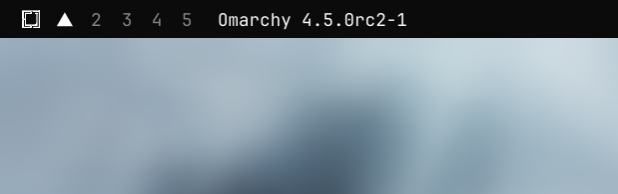

# Omarchy Version


An Omarchy bar widget that shows the installed Omarchy build, e.g. `Omarchy 4.5.0rc2-1`.

It reads `pacman -Q omarchy` (falling back to `omarchy version`), refreshes every
30 minutes, and refreshes immediately when you left-click it.

## Install

```sh
omarchy plugin add https://github.com/maiosx/omarchy-version.git --enable
```

The widget is added to the right side of the bar. To move it:

```sh
omarchy bar move maiosx.omarchy-version --section left     # or center / right
```

If it doesn't appear right away:

```sh
omarchy-shell shell rescanPlugins
omarchy plugin list --json | jq '.[] | select(.id == "maiosx.omarchy-version")'
```

## Update

```sh
omarchy plugin update maiosx.omarchy-version
```

## Remove

```sh
omarchy plugin remove maiosx.omarchy-version
```

## Manual install

```sh
git clone https://github.com/maiosx/omarchy-version.git \
  ~/.config/omarchy/plugins/maiosx.omarchy-version
omarchy plugin validate ~/.config/omarchy/plugins/maiosx.omarchy-version
omarchy-shell shell rescanPlugins
```

## Troubleshooting

Check the shell log for QML errors:

```sh
qs log -p "$OMARCHY_PATH/shell" --tail 100
```

## License

MIT
